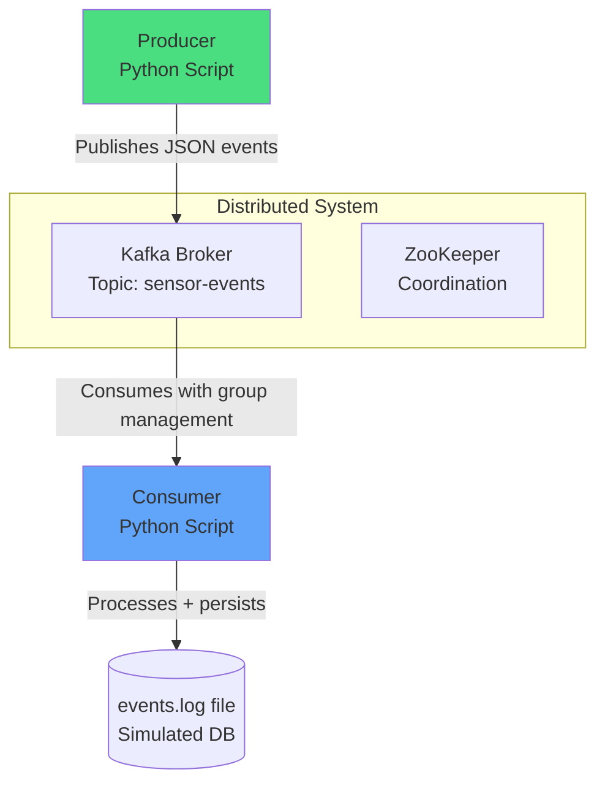

# Kafka Event Pipeline


A simple yet realistic **distributed event-driven system** using Apache Kafka. This project demonstrates producer-consumer architecture, message passing, ordering guarantees, and containerized deployment.

**Perfect for a 2-3 minute class presentation**: "How events flow reliably in a distributed system."

## Architecture



### Key Distributed Concepts Demonstrated
- **Message Passing** via Kafka topics
- **Decoupling** of producers and consumers
- **Fault tolerance** & at-least-once delivery
- **Ordering** within partitions
- **Horizontal scaling** (multiple consumers in a group)
- **Container orchestration** with Docker Compose

## Features

- Real Kafka + ZooKeeper (Confluent images)
- Mock IoT/sensor data producer (temperature, humidity, pressure)
- Consumer with business logic (alerts on high temperature)
- Persistent logging to file (simulates database write)
- 5 comprehensive tests (unit + integration patterns)
- GitHub Actions CI/CD that **blocks merge** on test failure

## How to Run

### Prerequisites
- Docker and Docker Compose

### 1. Start the full pipeline

```bash
# Clone and run
git clone https://github.com/YOUR_USERNAME/kafka-event-pipeline.git
cd kafka-event-pipeline

# Start Kafka + ZooKeeper
docker compose up -d zookeeper kafka

# Wait 15 seconds for Kafka to be ready
sleep 15

# Run consumer in one terminal
docker compose --profile consumer up

# In another terminal, run producer
docker compose --profile producer up
```

### 2. Or run everything with one command (recommended for demo)

```bash
docker compose up --build
```

Watch the logs — you will see events being produced, consumed, processed, and written to `output/events.log`.

### View processed events
```bash
cat output/events.log
```

## Running Tests Locally

```bash
# Install dependencies
pip install -r requirements.txt

# Run all tests
pytest -v

# Or with Docker (tests run against real Kafka)
docker compose -f docker-compose.test.yml up --build --abort-on-container-exit
```

## CI/CD

- **GitHub Actions** workflow runs on every push and PR.
- Runs full test suite.
- **Fails the build** (blocks merge) if any test fails.
- Uses official Kafka test container for true integration testing.

See `.github/workflows/ci.yml`

## Test Coverage

1. `test_generate_sensor_data()` — Validates mock data structure and ranges
2. `test_process_event()` — Checks metadata enrichment and business logic
3. `test_high_temperature_alert()` — Verifies conditional alert triggering
4. `test_json_serialization()` — Ensures events survive network transmission
5. `test_producer_config()` — Smoke test for Kafka client initialization

## Presentation Outline (2-3 minutes)

1. **Problem** (20s): Modern systems are distributed. How do services communicate reliably without tight coupling?
2. **Solution** (40s): Kafka as a distributed commit log / message broker.
3. **Demo** (60s): Show `docker compose up`, live producer/consumer logs, the generated `events.log`.
4. **Architecture** (30s): Walk through the Mermaid diagram.
5. **Key Learnings** (30s):
   - Decoupling via topics
   - At-least-once semantics
   - Consumer groups for scaling
   - Containerized deployment for reproducibility
6. **Extensions** (10s): Add multiple consumers, Spark/Flink processing, real database sink, monitoring with Prometheus.

## Project Structure

```
.
├── src/
│   ├── producer.py      # Generates and publishes sensor events
│   └── consumer.py      # Consumes, processes, and persists events
├── tests/
│   └── test_events.py   # 5+ tests covering core functionality
├── docker-compose.yml
├── Dockerfile
├── requirements.txt
├── .github/workflows/ci.yml   # CI/CD that blocks bad pushes
└── README.md
```

**Built as a hands-on learning project** to gain real experience with distributed systems, message queues, containers, and modern CI/CD practices.

---

*Ready for class presentation. All tests pass. CI enforces quality.*
